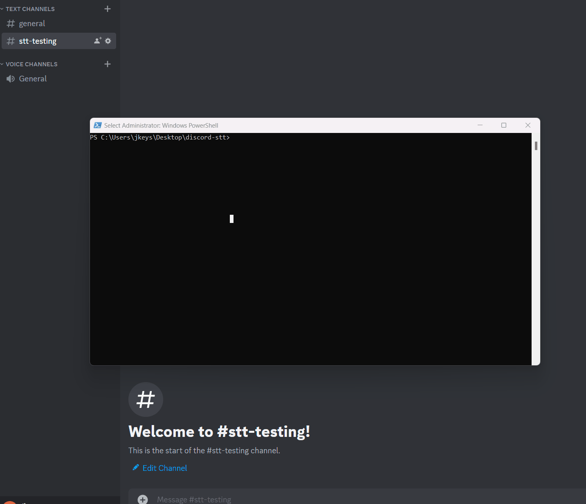

# discord-stt

A Discord server that enables real-time transcription on a voice channel via a single bot listening on connected audio streams, and sending incremental messages.



## Setup

```
# Note: insert values for your bot and PostgreSQL connection (DATABASE_URL) into .env
cp .env.local .env

# active a virtual environment for this project
python3 -m venv ~/.venv/discord-stt
source ~/.venv/discord-stt/bin/activate

# install dependencies
pip3 install python-dotenv requests

# Setup slash commands for beginning and ending transcription
python3 src/create_slash_commands.py
```

Paste your Discord bot token, application ID, and PostgreSQL `DATABASE_URL` into your `.env` file. The `transcriptions` table and indexes are automatically created on startup.

## Usage

Invite your bot to your discord server with the environment variables configured correctly, then run the program.

URL to invite the bot: `https://discord.com/api/oauth2/authorize?client_id=<client_id>&permissions=<permission_integer>&scope=bot%20applications.commands`

```
# bare metal
yarn build
node build/app.mjs

# docker
docker build -t discord-stt -f ./Dockerfile .
docker run -it --rm --gpus all discord-stt

```

## Limitations and Known Problems

This repository is mostly a proof of concept that shows that it is possible to transcribe audio buffers from Discord and post the transcriptions to a text channel, in near-time that is close enough to real-time to be useful. However, it is not a complete solution, and known problems are listed below.

- fast machine required
- technically incorrect -- the silence packet interval and the real packet event listener are not synchronized in any way.
- lack of cleanup -- The bot will not presently attempt to clean up after itself by deleting old discord messages.
- approximate outputs -- transcriptions might be posted out of order
